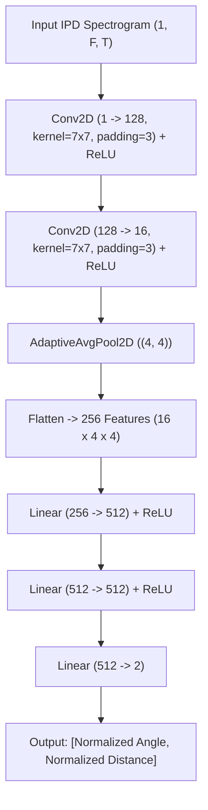

# 3D Sound Source Localization Using Real-World Acoustic Impulse Responses (MIRD)

[](https://github.com/)
[](https://github.com/)
[](https://pytorch.org/)
[](https://python.org/)

---

## 👥 Project & Team Information

- **Subject:** Introduction to AIML
- **Team ID:** Team - A13
- **Team Members:**
  - **Kirithik B** (CB.AI.U4AID25023)
  - **V Amruth** (CB.AI.U4AID25057)
  - **Vishnu Prasad P** (CB.AI.U4AID25059)
  - **Sankardas KK** (CB.AI.U4AID25048)

---

## 📌 Executive Summary

This project implements a robust deep learning pipeline for **3D Acoustic Source Localization** (joint estimation of **Azimuth Angle** and **Radial Distance**) in reverberant and noisy real-world acoustic environments.

Rather than relying purely on ideal simulated room impulse responses, this work integrates real measured impulse responses from the **Multichannel Impulse Response Database (MIRD)**. Speech signals are convolved with multi-channel room impulse responses (RIRs) under variable reverberation times ($RT_{60}$) and additive white Gaussian noise (AWGN) across a wide range of signal-to-noise ratios (0 dB to 30 dB). 

Feature extraction is based on the **Interaural Phase Difference (IPD)** spectrogram computed within the spatial Nyquist frequency bound to eliminate spatial phase ambiguity. A convolutional regression neural network (**CNN-R**) is trained to predict continuous spatial coordinates directly from the acoustic phase representations.

---

## 🔬 Theoretical Background & Acoustic Signal Processing

### 1. Interaural Phase Difference (IPD)
For a two-microphone array spaced by distance $d$, sound emitted by a source arrives at each microphone with a relative time delay of arrival (TDOA):
$$\tau = \frac{d \cdot \cos(\theta)}{c}$$
where:
- $\theta$ is the sound arrival angle (azimuth),
- $c \approx 343\text{ m/s}$ is the speed of sound in air,
- $d = 0.26\text{ m}$ is the microphone array spacing (channels 0 and 7).

In the short-time Fourier transform (STFT) domain, the cross-channel relationship between microphone channels $Y_a(f, t)$ and $Y_b(f, t)$ yields the Interaural Phase Difference (IPD):
$$\text{IPD}(f, t) = \angle \left( \frac{Y_a(f, t)}{Y_b(f, t)} \right) \in [-\pi, \pi]$$

### 2. Spatial Aliasing & Valid Frequency Bound
When the acoustic wavelength $\lambda = \frac{c}{f}$ becomes smaller than twice the microphone spacing ($2d$), phase wrapping produces spatial ambiguity (aliasing). To prevent ambiguous spatial phase representations, feature extraction is strictly restricted below the spatial Nyquist cutoff:
$$f_{\max} = \frac{c}{2d} = \frac{343}{2 \times 0.26} \approx 659.62\text{ Hz}$$
Only frequency bins up to $f_{\max}$ are retained in the IPD feature matrices.

### 3. Reverberation Modeling ($RT_{60}$)
Real-world RIRs are sourced from MIRD at varied reverberation decay times ($RT_{60} = 0.16\text{ s}, 0.36\text{ s}, 0.61\text{ s}$, etc.). RIR windows are dynamically scaled according to $(RT_{60} + 0.2)\text{ s}$ to capture the full reverberation decay tail without truncating early reflections or late reverberation.

### 4. Noise Robustness (AWGN)
Synthetic acoustic mixtures are generated with Additive White Gaussian Noise across 7 distinct SNR regimes:
$$\text{SNR}_{\text{dB}} \in \{0, 5, 10, 15, 20, 25, 30\}$$
ensuring the neural network learns features resilient against severe background noise.

---

## 🏗️ Neural Network Architecture (CNN-R)

The regression model (`CNN-R`) is a 2D Convolutional Neural Network designed to extract spatio-temporal phase representations and map them to normalized spatial coordinates.



### Layer Details:
- **Input:** Normalized IPD matrix $\frac{\text{IPD}}{180^\circ} \in [-1, 1]$ padded along the time dimension to `MAX_T`.
- **Feature Extraction:** 
  - 2 stacked Conv2D layers with large receptive fields ($7 \times 7$) to capture broad frequency and time-dependent acoustic phase trajectories.
- **Dimensionality Reduction:** 
  - `AdaptiveAvgPool2d((4, 4))` compresses variable time-length inputs into a fixed feature representation ($16 \times 4 \times 4 = 256$).
- **Regression Head:**
  - Fully connected layers ($256 \to 512 \to 512 \to 2$) with ReLU activations.
- **Output Targets:**
  - Azimuth Angle: $\hat{y}_0 \times 180^\circ$
  - Radial Distance: $\hat{y}_1 \times 2.0\text{ m}$

---

## 📁 Repository Structure

```
3D_Localization_real_data/
├── best_cnn_r_mird.pt          # Saved PyTorch checkpoint of best-performing model
├── dataset_mird/               # Extracted IPD spectrograms (.npy) and labels.csv
├── generate_mird_dataset.py    # Acoustic simulation & IPD dataset generation
├── mird_training_curve.png     # Training vs. Validation MAE loss curves
├── requirements.txt            # Python dependencies
├── scan_mird_coverage.py       # Utility to scan and audit MIRD .mat dataset coverage
├── train_mird.py               # Model definition, clip-based train/val/test loop & evaluation
├── visualizationdata.py        # Visual inspection script for sample IPD feature maps
└── README.md                   # Detailed project documentation
```

---

## ⚙️ Installation & Setup

### 1. Prerequisites
- Python 3.9, 3.10, 3.11, or 3.12
- Recommended: NVIDIA GPU with CUDA support for accelerated training (CPU is also supported)

### 2. Environment Setup
Create and activate a virtual environment:

**On Windows (PowerShell):**
```powershell
python -m venv venv
.\venv\Scripts\Activate.ps1
```

**On Linux / macOS:**
```bash
python3 -m venv venv
source venv/bin/activate
```

### 3. Install Dependencies
```bash
pip install --upgrade pip
pip install -r requirements.txt
```

If you wish to use PyTorch with CUDA acceleration, install the official CUDA-enabled PyTorch build from [pytorch.org](https://pytorch.org/get-started/locally/).

---

## 🚀 Execution & Usage Guide

### Step 1: Verify MIRD Database Coverage
Inspect the available real-world impulse response measurements:
```bash
python scan_mird_coverage.py
```
*Output summarizes all available angles, distances, sampling frequencies, and RT60 reverberation configurations.*

### Step 2: Generate the Acoustic Dataset
Configure your source paths in `generate_mird_dataset.py`:
- `MIRD_ROOT`: Path to the downloaded MIRD `.mat` impulse response directory.
- `AUDIO_DIR`: Path to clean 16 kHz speech audio clips.

Run the generator:
```bash
python generate_mird_dataset.py
```
This script will:
1. Verify orientation and microphone spacing ($d = 0.26\text{ m}$).
2. Convolve audio clips with real RIR pairs.
3. Inject multi-level AWGN ($0\text{ dB}$ to $30\text{ dB}$).
4. Extract IPD feature matrices and save them as `mird_XXXXXX.npy` inside `dataset_mird/`.
5. Write the metadata and ground-truth coordinates to `dataset_mird/labels.csv`.

### Step 3: Inspect IPD Spectrogram Features
Visualize an extracted sample to observe interaural phase characteristics across frequency bins and time frames:
```bash
python visualizationdata.py
```

### Step 4: Train and Evaluate the Model
Train the `CNN-R` model:
```bash
python train_mird.py
```

#### Training Configuration:
- **Batch Size:** 64
- **Epochs:** 50
- **Optimizer:** Adam ($\text{lr} = 10^{-3}$, $\text{weight decay} = 10^{-3}$)
- **Loss Function:** L1 Loss (MAE)
- **Data Splitting Strategy:**
  - **Strict split by speech clip ID** (70% Train, 10% Validation, 20% Test).
  - *Why?* Real spatial impulse responses exist for fixed spatial points. Random record splitting causes the model to memorize positions for existing voices. Splitting by unique audio clips guarantees rigorous generalization testing on unseen human speakers.

---

## 📊 Evaluation & Metrics

The system evaluates localization performance using:
1. **Mean Absolute Error (MAE):**
   - Angle MAE in degrees ($^\circ$)
   - Distance MAE in meters ($\text{m}$)
2. **Threshold Baseline Accuracy:**
   - **Angle Accuracy:** $|\hat{\theta} - \theta| < 7.5^\circ$ (half of the $15^\circ$ measurement grid step).
   - **Distance Accuracy:** $|\hat{r} - r| < 0.5\text{ m}$ (half of the $1.0\text{ m}$ measurement grid step).
3. **Per-Angle Breakdown:**
   - Detailed angular breakdown reporting precision across each azimuth position.
4. **Learning Dynamics:**
   - Checkpoint saved to `best_cnn_r_mird.pt` based on minimum validation loss.
   - Training vs. Validation curve generated and saved to `mird_training_curve.png`.

---

## 📚 References & Resources

- **MIRD Dataset:** *Multichannel Impulse Response Database*, recorded in a reverberant environment with variable acoustic configurations.
- **Binaural Localization:** Spatial acoustic feature processing using Interaural Phase Difference (IPD) and Interaural Time Difference (ITD).
- **Deep Learning for Acoustic SLAM / DOA:** Convolutional regression architectures for Direction of Arrival (DOA) and range estimation.

---

## 📄 License & Attribution

Developed for academic coursework under **Introduction to AIML**, Team **A13**.  
For questions or project clarifications, please reach out to the team members.
